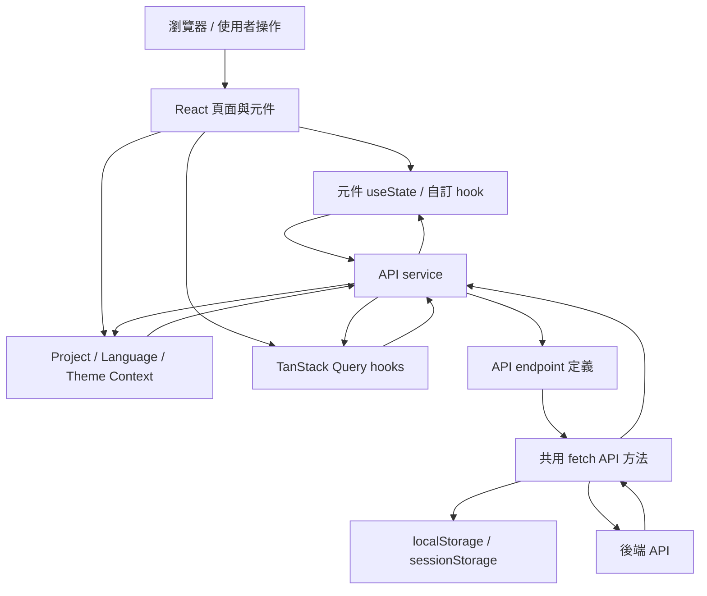

# 專案狀態與資料流

本文依照目前前端程式碼整理，描述狀態放置位置、初始化順序，以及畫面與 API 之間的資料流。實作如有調整，請同步更新本文。

## 架構概覽

## 應用啟動與 Provider

入口為 [`src/main.tsx`](../src/main.tsx)。初始化 i18n 的語言資源後才建立 React root，並在路由外層依序提供：

1. `QueryClientProvider`：TanStack Query 快取與查詢環境。
2. `LanguageProvider`：目前語言、可用語言與系統設定。
3. `ProjectProvider`：專案清單與目前專案。
4. `ThemeModeProvider` 與 MUI `ThemeProvider`：主題模式及對應 theme。
5. `RouterProvider`、全域 toaster。

`ProjectProvider` 初次載入專案清單期間會顯示全頁 loading，初始化完成後才顯示路由內容。主要路由由 [`src/routes/routes.tsx`](../src/routes/routes.tsx) 定義；`/:projectId?` 下的頁面使用共用 `Index` / `Layout`。

## 狀態放置位置

| 狀態類型 | 所在位置 | 範例與生命週期 |
| --- | --- | --- |
| 頁面/元件狀態 | 元件內的 `useState` | 表格資料、對話框開關、表單欄位；通常在元件卸載時消失。 |
| 專案狀態 | [`src/contexts/ProjectContext.tsx`](../src/contexts/ProjectContext.tsx) | 專案清單、目前專案、無效路由專案 ID、載入錯誤。 |
| 語言與系統設定 | [`src/contexts/LanguageContext.tsx`](../src/contexts/LanguageContext.tsx) | 目前 locale、支援/啟用語言、系統設定。i18next 負責翻譯查找。 |
| 主題狀態 | [`src/main.tsx`](../src/main.tsx)、[`src/hooks/useThemeMode.tsx`](../src/hooks/useThemeMode.tsx) | `light` / `dark`，儲存在 `localStorage` 的 `theme-mode`。 |
| 伺服器快取狀態 | TanStack Query | 目前有 `src/hooks/useProject.tsx`、`src/hooks/useUiTextsNested.tsx` 使用 `useQuery`；其他資料仍常由元件直接載入。 |
| 操作中的 loading/error | 各自呼叫 `useLoading` 的元件或 Context | [`src/hooks/useLoading.tsx`](../src/hooks/useLoading.tsx) 以 key 分開管理同一 hook 實例內的 loading；它不是全域共用 store。 |
| 跨頁請求資訊 | `localStorage` / `sessionStorage` | access token、語言、目前專案 ID；頁面重新整理後仍可供 API 層讀取。 |

### 專案選擇

[`ProjectContext`](../src/contexts/ProjectContext.tsx) 載入專案清單後，優先順序為：URL 第一段的專案 ID、`sessionStorage.projectId`、清單第一個專案。選擇專案時會更新 Context 並寫入 `sessionStorage.projectId`。無效的 URL 專案 ID 會交由 [`src/pages/Index.tsx`](../src/pages/Index.tsx) 顯示 `ProjectNotFound`。

API 共用層從 `sessionStorage` 讀取專案 ID，並以 `X-Project-Id` request header 傳給後端。因此，專案選擇會影響後續 API 請求，不需要每個 service 個別傳入專案 ID。

### 語言與主題

`LanguageProvider` 載入後端支援語言與系統設定；切換語言時更新 localStorage、i18next 及 Context。API request 會附上 `Accept-Language`。啟動時的翻譯檔由 `src/settings/i18n.ts` 初始化，語系 JSON 位於 `public/locales/`。

主題由 `AppRoot` 維護，從 `localStorage.theme-mode` 還原；沒有儲存值時依系統深色模式偏好初始化，之後每次變更都寫回 localStorage。

## API 資料流

一般資料請求的分層如下：

1. 頁面或 hook 呼叫 `src/api/services/` 中的 service。
2. Service 使用 `src/api/base/apiEndpoint.ts` 的 endpoint，並呼叫 `src/api/base/apiMethods.ts` 匯出的 `GET`、`POST`、`PUT`、`PATCH` 或 `DELETE`。
3. 共用 API 方法透過 `src/api/base/helpers.ts` 組 URL，並從瀏覽器儲存讀取 API base URL、token、專案 ID、語言。
4. Request 會依內容型別加上 JSON header，必要時附上 `Authorization: Bearer ...`、`X-Project-Id`、`Accept-Language`。
5. 成功回應預期為 `{ success, message, data }`；共用層檢查 `success` 並回傳 `data`。失敗時轉成 `Error`，供呼叫端處理。
6. 呼叫端把資料寫入元件 state、Context，或由 TanStack Query 管理。

API base URL 由 `window.__APP_CONFIG__.API_BASE_URL` 提供，未設定時預設為 `/api/`。部署時可透過 `public/config.js` 或部署環境提供的 `config.js` 調整，而不必重建前端 bundle；相關部署說明見 [`README.md`](../README.md)。

## 兩種畫面資料模式

### 直接載入到元件 state

多數頁面透過 `useEffect` 呼叫 service，再把回傳值寫進 `useState`。頁面負責決定重新載入時機、loading/error 顯示和資料轉換。`useLoading` 提供 key-based loading 標記，但不會自動包裝 API 請求。

### TanStack Query

少數 hook 使用 `useQuery`，並指定 `queryKey` 與 `queryFn`。已見到的使用位置為 `src/hooks/useProject.tsx` 與 `src/hooks/useUiTextsNested.tsx`。注意：`src/hooks/useProject.tsx` 匯出的 `useProject` 是 React Query hook；應用中同名的 `useProject` 也由 `src/contexts/ProjectContext.tsx` 匯出，使用時需依 import 路徑辨認其資料來源。

## 範例：資料品質與穩態報表

以 [`DataQualityAndSteadyStateReportPage.tsx`](../src/pages/EnergySavingSimulation/DataQualityAndSteadyStateReport/DataQualityAndSteadyStateReportPage.tsx) 為例：

1. 頁面首次掛載時呼叫 `loadReport()`；使用者按重新整理時也呼叫同一函式。
2. `loadReport()` 呼叫 `tagMappingService.calculate()`。
3. [`src/api/services/tagMapping.ts`](../src/api/services/tagMapping.ts) 對 `tag-mapping/calculate` 發出 POST，沒有額外 request body。
4. 共用 API 層附上目前專案/語言等 headers，檢查回應並回傳 `data`。
5. 頁面將結果存入 `reportData`，再從資料建立品質指標、系統 KPI、圓餅圖與能源明細表。

此頁使用元件本地 `useState`，沒有透過 React Query 快取結果；目前程式也沒有將請求狀態或錯誤連到畫面上。因此重新整理資料不會由 Query invalidation 驅動，載入失敗時需由呼叫端另行處理。

## 維護注意事項

- 新增資料流程時，沿用 `service -> endpoint -> 共用 API 方法` 分層；元件不直接拼 API URL 或自行重複建立 headers。
- 決定伺服器資料要放在本地 state 或 TanStack Query 時，需明確選擇快取、重新整理與錯誤處理責任；目前專案兩種模式並存。
- 專案 ID、token、語言目前由共用層直接讀取瀏覽器儲存。若將來改成其他認證或專案選擇機制，應同步調整 API headers 的來源。
- `QueryClient` 目前在 `AppRoot` render 內建立（見 `src/main.tsx`）。由於 `AppRoot` 的主題 state 會更新並觸發 render，QueryClient 可能隨之重建，造成 Query 快取被重置；若擴大使用 TanStack Query，應將 QueryClient 穩定化。